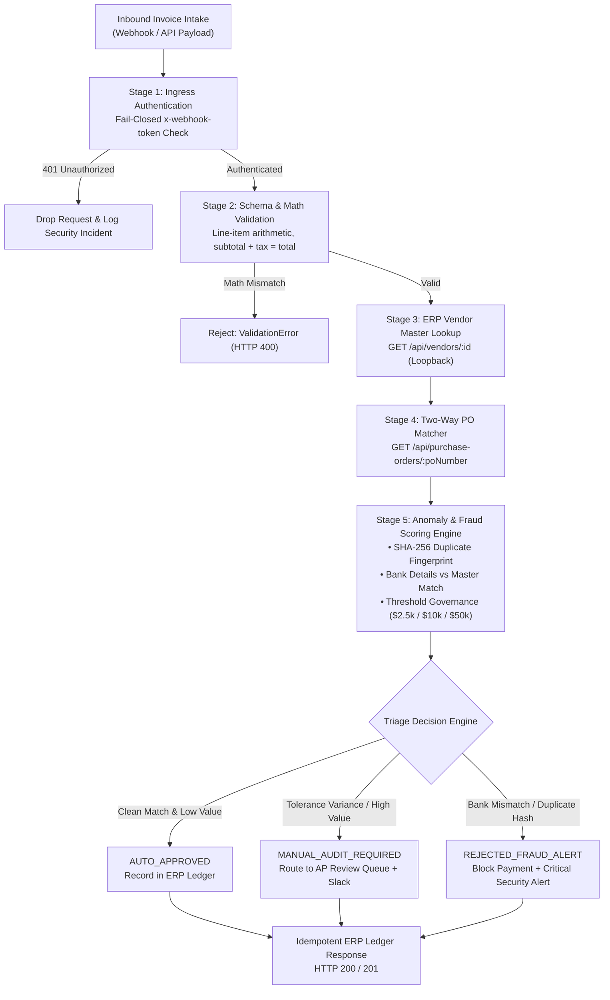

# Architecture Specification: Intelligent Accounts Payable (AP) Invoice Audit Pipeline

## 1. Executive Summary & Problem Context
In enterprise and mid-market organizations, manual Accounts Payable (AP) processing is fraught with financial leakage:
1. **Invoice Fraud & Business Email Compromise (BEC):** Attackers compromise vendor email accounts or submit spoofed invoices with modified bank account numbers, diverting payments to attacker-controlled accounts.
2. **Duplicate Invoicing:** Vendors submitting invoices via multiple channels (e.g. portal, email, and mail) resulting in accidental double payments.
3. **Line-Item Math & Tax Inaccuracies:** Calculation errors across complex multi-line deliverables and varying tax jurisdictions.
4. **Unmatched Purchasing Overruns:** Invoices billed without active Purchase Orders (POs) or exceeding contracted amounts.

This reference architecture implements an **automated, fail-closed audit pipeline** that validates incoming invoices, enforces cryptographic deduplication, verifies two-way PO matching against ERP records, evaluates fraud heuristics, and routes invoices safely into an accounting ledger.

---

## 2. System Topology & Pipeline Lifecycle

---

## 3. Pipeline Stages & Verification Responsibilities

### Stage 1: Ingress Authentication & Rate Limiting
- **Mechanism:** HTTP header validation (`x-webhook-token` or `x-erp-api-key`).
- **Enforcement:** Fail-closed. Missing or mismatched tokens terminate processing immediately with `HTTP 401 Unauthorized`.
- **DoS Defense:** Bounded streaming parser enforces a hard $256\text{ KB}$ request ceiling, destroying sockets that exceed bounds (`HTTP 413`).

### Stage 2: Schema & Mathematical Verification (`lib/invoice-validator.js`)
- Enforces mandatory fields: `invoice_number`, `vendor_id`, `invoice_date`, `due_date`, `currency`, `line_items`, `subtotal`, `tax_amount`, `total_amount`, `bank_details`.
- Calculates line-item arithmetic: $\sum (\text{qty} \times \text{unit\_price})$. Reconciles subtotal to line items within $\$0.01$.
- Reconciles subtotal + tax to declared total within $\$0.01$.
- Rejects inverted dates (`due_date < invoice_date`) and non-numeric/negative quantities.

### Stage 3 & 4: Two-Way PO Matching (`lib/po-matcher.js`)
- Queries ERP for active Purchase Order.
- Validates PO status (`APPROVED` or `OPEN`).
- Verifies vendor ID and currency agreement.
- Calculates variance:
  - $\le 0.00$: `MATCHED_UNDER_BUDGET`.
  - $0.01\text{ to } 1.0\%$ (max $\$25$): `MATCHED_WITHIN_TOLERANCE` (flags review).
  - $> 1.0\%$: `BUDGET_OVERRUN` (fails match, routes to audit queue).

### Stage 5: Anomaly & Fraud Detection Engine (`lib/anomaly-detector.js`)
- **Cryptographic Fingerprint:** $\text{SHA-256}(\text{vendor\_id} + \text{"::"} + \text{invoice\_number})$. Prevents duplicate ingestion across disparate channels.
- **Vendor Bank Account Divergence:** Compares invoice payment routing against ERP master record. Divergence indicates Business Email Compromise (BEC) and adds 80 fraud points.
- **Threshold Escalation Tiers:**
  - Tier 1 ($< \$2,500$): Standard / Auto-approval eligible.
  - Tier 2 ($\$2,500\text{--}\$10,000$): Manager review threshold.
  - Tier 3 ($\$10,000\text{--}\$50,000$): Director review threshold.
  - Tier 4 ($\ge \$50,000$): Executive / CFO review threshold.

### Stage 6: Mock ERP Ledger Ingestion (`mock-erp/`)
- Express-compatible zero-dependency HTTP server (`node:http`) listening exclusively on `127.0.0.1:3002`.
- Stores vendor master records, active POs, and an immutable audit log.
- Enforces event idempotency: Duplicate requests return cached `HTTP 200` without creating duplicate payments or duplicate alerts.

---

## 4. Technology Stack & Zero-Dependency Footprint
- **Runtime:** Node.js 24 LTS (Pure built-in standard library: `node:http`, `node:crypto`, `node:fs`, `node:assert`, `node:path`, `node:child_process`).
- **External Dependencies:** **Zero external npm packages**. Eliminates supply-chain attack vectors.
- **Network Interface:** `127.0.0.1` (Strict loopback isolation).
- **Workflow Automation:** n8n 16-node orchestration graph (`workflow/invoice-audit-workflow.json`).
